# CampusFix

## Smart Campus Maintenance Complaint Management System

University Java OOP Project Report

Member 1 — [Full name] · [Roll number]

Member 2 — [Full name] · [Roll number]

Member 3 — [Full name] · [Roll number]

Member 4 — [Full name] · [Roll number]

Course and code — [Course name and code]

Semester — [Semester and academic year]

Institution — [Institution and department]

Submission date — 30 November 2026

Demonstration — 4–7 December 2026

<!-- page -->
## Abstract

CampusFix is a Java Swing application that organizes university maintenance requests from submission through resolution. Students register issues and follow their own tickets. Administrators triage the campus queue, review rule-based recommendations, and assign technicians. Technicians update assigned work and provide a resolution note. An activity timeline records important actions and provides reliable resolution timestamps when available. The application calculates explainable priority scores and severity-based service deadlines, then presents filtered operational metrics and exports CSV reports. A repository interface separates business rules from versioned local files and optional SQLite storage accessed through JDBC. The project demonstrates inheritance, abstraction, encapsulation, polymorphism, event handling, and exception handling in one workflow. Automated checks exercise permissions, transitions, report safety, and persisted state using isolated file and database fixtures.

## Introduction and Problem Statement

Maintenance requests can arrive through conversations, email, and informal messages. This makes it difficult to tell who owns the work, whether a report is still open, and how long an issue has waited. Students also need a way to follow progress without access to other students’ tickets. CampusFix brings the report, responsible technician, current status, and recorded history into one desktop application.

## Objectives and Scope

The objectives are to provide a consistent intake process, route jobs to appropriate technicians, make operational priority explainable, and preserve complaint history across restarts. A filterable campus view gives administrators information for daily triage. The classroom implementation is a single-process Java desktop application with local data and public demo accounts. The same scenarios can be demonstrated with only the JDK or with a SQLite JDBC driver on the runtime classpath.

<!-- page -->
## Requirements Analysis

### Functional Requirements

- Students submit a title, description, location, category, and severity. They see their own complaints and can add comments or view history.
- Administrators inspect all tickets, review recommendations, confirm assignment or reassignment, advance valid workflow states, review analytics, and export reports.
- Technicians see their assigned tickets and history, record progress on active assignments, and advance or resolve authorized work.
- The system calculates priority and service-level timing, supports combined filters and sorting, records workflow events, and reloads saved data.
- CSV reports support visible complaint data, the filtered table, an SLA summary, and technician workload. Campus-wide summaries require the administrator role.

### Nonfunctional Requirements

The source targets Java 17 and builds with a newer JDK through the included scripts. The standard launch requires no network or external libraries. Common actions must present useful errors and keep the interface responsive. Existing v1 files stay readable. Role boundaries apply at the service layer, and credentials belonging to real people must stay out of source control, reports, and screen captures.

## Use Cases

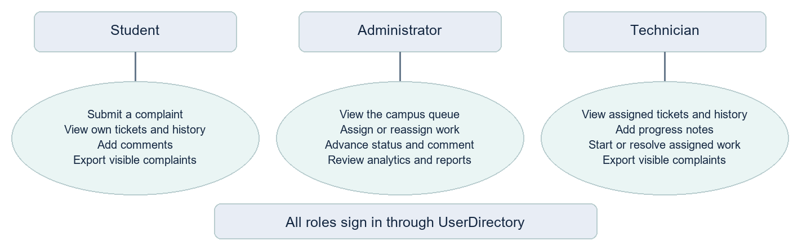

An assignment connects two workflows. The administrator confirms the technician, and the selected technician can then find the complaint in Assigned Tickets. The reporting student keeps visibility throughout the lifecycle.

<!-- page -->
## System Architecture

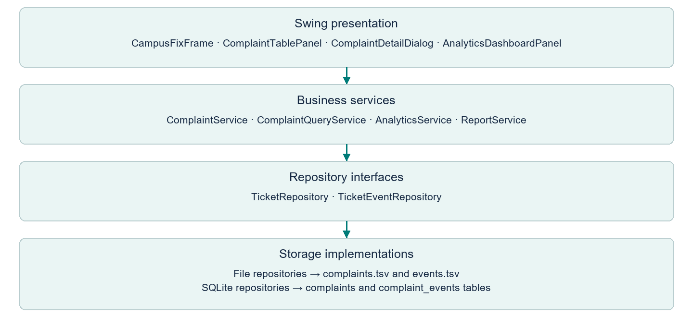

`CampusFixApp` selects storage and constructs the services before launching the frame on the Swing event-dispatch thread. The frame routes views by role. `ComplaintService` owns authorization and state changes. `ComplaintQueryService` applies search, filters, and ordering. `AnalyticsService` creates a snapshot from authorized data, and `ReportService` controls access to summaries and delegates the CSV encoding.

The storage interfaces are the substitution points. Both ticket repositories accept the same complaint model, and both durable event repositories return events by complaint ID. Changing the storage implementation leaves the ticket lifecycle and UI contracts the same.

## Complaint Lifecycle

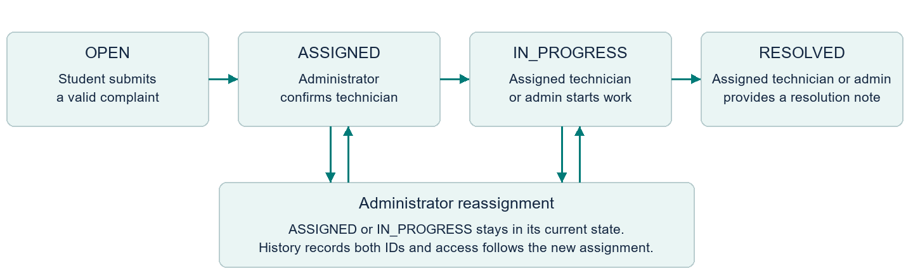

A student creates an OPEN complaint. An administrator assigns it, and the administrator or assigned technician can start work and later resolve it. Resolution requires a 10–1,000 character note. Reassignment preserves ASSIGNED or IN_PROGRESS and transfers access to the new technician. RESOLVED is terminal in the current workflow.

<!-- page -->
## UML Class Diagram

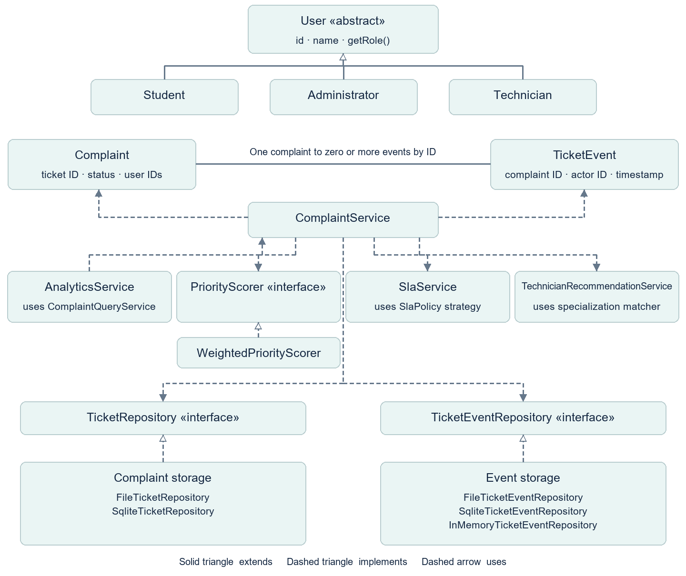

`Complaint` stores student and technician IDs. `TicketEvent` refers to the complaint and actor by ID, so events remain meaningful after reassignment. The repository interfaces express access contracts. `WeightedPriorityScorer` implements `PriorityScorer`, and `StandardSlaPolicy` supplies the default SLA durations and warning windows.

<!-- page -->
## Java Modules and OOP Implementation

### Classes Objects and Encapsulation

`Complaint` models a ticket with private state and controlled mutation methods. Repositories return separate complaint instances or copies so changing a displayed object does not immediately change stored state. `TicketEvent` stores an event ID, complaint ID, actor ID, type, time, and an optional note. Classes represent domain concepts while objects carry the state of individual requests.

### Abstraction Inheritance and Polymorphism

Abstract `User` holds shared identity. `Student`, `Administrator`, and `Technician` override `getRole()`, and the technician subtype adds a specialty. Callers can hold a reference typed as `User` and use the concrete role at runtime. The repository interfaces support the same kind of substitution for storage. The service can call `save` with a file repository or a JDBC repository behind the interface.

### Exceptions and Collections

`ValidationException` signals invalid input, access denial, and invalid status transitions. File and JDBC exceptions are wrapped with operation context and retain their causes. When a ticket saves and its event fails, the service reports the partial success. `EnumMap` stores category, severity, and status counts, `TreeMap` groups dates, and comparators order candidates and ticket results. The service serializes mutation operations within one application instance.

### File Handling and JDBC

The file repositories use UTF-8 Base64 for fields in tab-separated v1 records. Complaints have twelve fields and events have seven. This preserves line breaks and delimiters in user text. A complete temporary sibling is written before replacement. The SQLite repositories use the Xerial driver, initialize `complaints` and `complaint_events`, and index event lookup by ticket and time. They bind values in prepared statements, using SQLite upsert for ticket state and separate inserts for events. Try-with-resources closes connections, statements, and result sets. [2–4]

<!-- page -->
## Priority and Service Levels

`WeightedPriorityScorer` assigns severity points of 10, 25, 40, and 55 from LOW through CRITICAL. Electrical has a 15-point category weight, internet and plumbing have 12, cleaning 7, furniture 5, and other 4. Each completed six-hour wait contributes one point up to 20, with negative age treated as zero. Operational urgency contributes 10 for overdue work, 7 for due soon, and otherwise 5, 3, or 2 for OPEN, ASSIGNED, or IN_PROGRESS. RESOLVED adds zero urgency. The score is capped at 100 and the four contributions appear in the detail dialog and complaint CSV.

`SlaService` adds 4, 24, 72, or 168 calendar hours for CRITICAL, HIGH, MEDIUM, or LOW. Their warning windows are 1, 4, 12, and 24 hours. For active tickets, the clock determines whether the deadline is on track, due soon, or overdue. For resolved tickets, a persisted resolution event is required for compliance. A timestamp before creation is excluded, as are missing historical events.

## Technician Recommendations and Activity

`TechnicianRecommendationService` ranks a category-to-specialty match first, fewer active assignments second, and technician ID last. The default matcher uses declared text specialties. A fallback can still be recommended by workload when a match is unavailable. The administrator reviews the explanation and confirms the choice.

Ticket events capture creation, assignment and reassignment, status changes, comments, progress notes, and resolution. Event retrieval orders by timestamp and event ID. `ComplaintDetailDialog` combines those persistent events with the current complaint. Older tickets can have incomplete timelines and no reliable resolution time.

## Analytics and Reporting

Analytics shows the status, severity, category, and creation-date distributions and compares technician workload. Resolution rate divides resolved tickets by the filtered total. SLA compliance uses only known resolved outcomes. Average duration uses known recorded resolution times. Missing measures display as unavailable. Reports quote separators, quotes, and newlines and guard formula-like text. Exports require a new filename. Filtered table exports retain the displayed order and recheck each record’s visibility.

<!-- page -->
## Swing Interface and Student Views

`CampusFixFrame` presents a consistent navigation shell for each role. `ComplaintTablePanel` combines a filter bar, table, and lightweight preview. Background workers prepare filtered rows and report data, and the EDT applies results and handles user events. The dedicated analytics module renders its data using Java2D. [1]

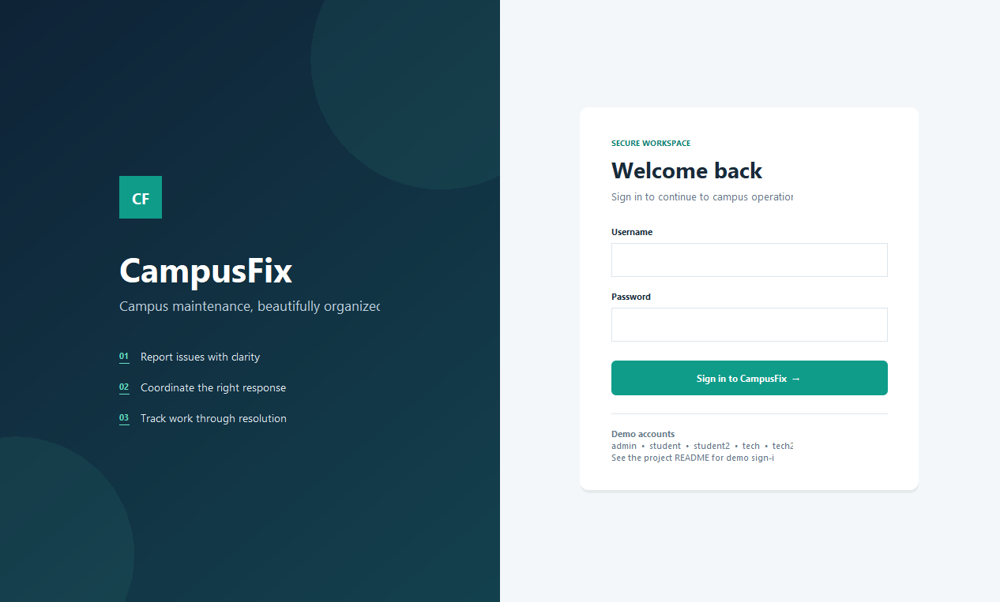

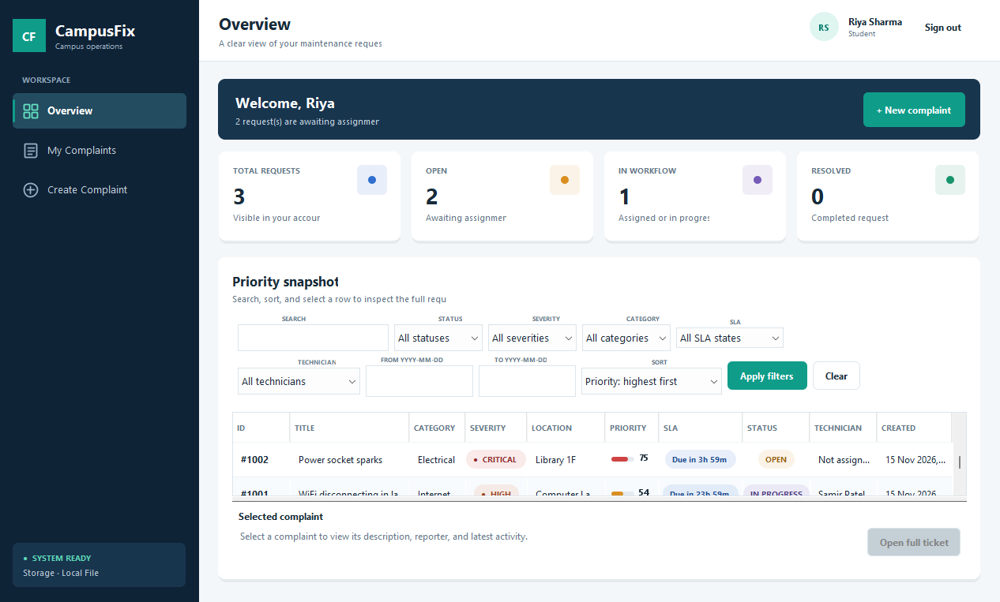

<!-- page -->
## Complaint Intake and Administration

The complaint form collects the information required by the service. An administrator sees the campus-wide totals and the priority snapshot, and can open the assignment queue or inspection dialog.

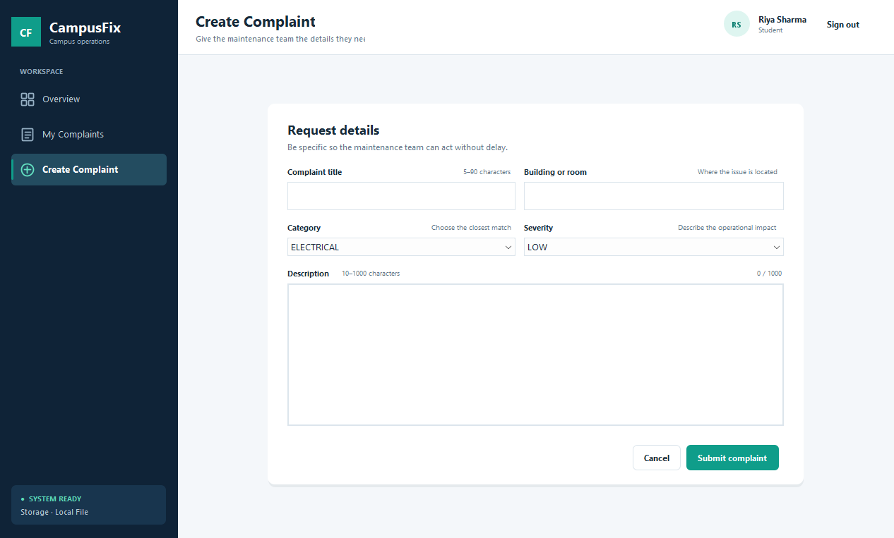

<!-- page -->
## Complaint Details and Technician Workflow

The details dialog shows current state, the score breakdown, metadata and deadline, and the event timeline. The assigned technician’s dashboard includes their work queue and completed work.

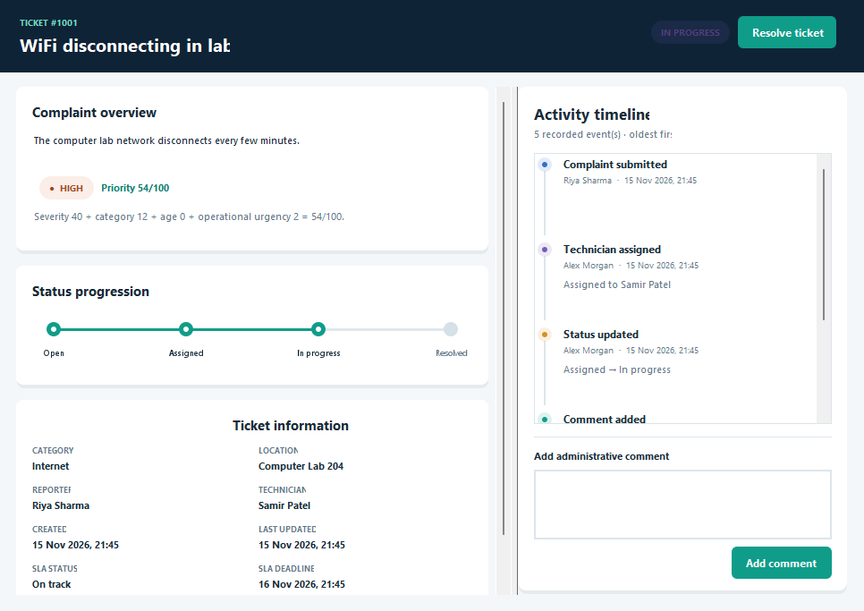

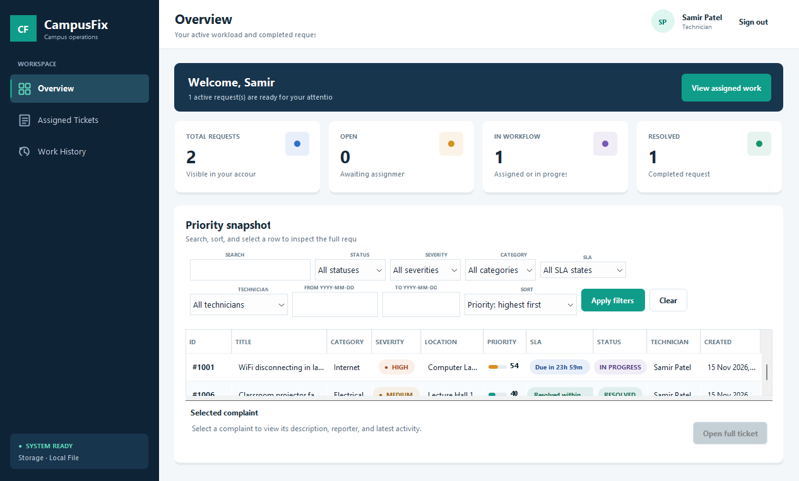

<!-- page -->
## Operational Reporting Screens

The analytics view applies the selected filters across KPI cards and charts. The assignment dialog explains the suggestion and requires confirmation. The report chooser offers the four administrator report types. Full-resolution evidence, including separate timeline and SLA close-ups, is in the screenshots directory.

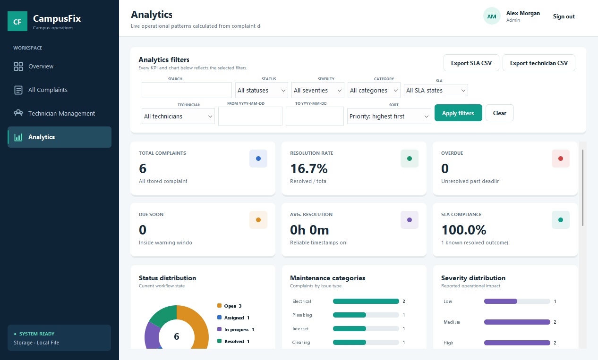

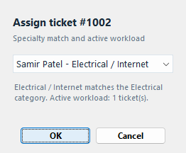

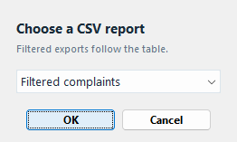

<!-- page -->
## Testing and Results

### Method

The suite uses deterministic clocks for algorithm expectations and synthetic temporary repositories. `SmokeTest` invokes the history, operational logic, and reporting suites. Persistence tests construct new repository instances from the same temporary files or database. The screenshot harness creates an actual Swing window, navigates its controls, and captures rendered components without including the surrounding desktop.

### Verified Results

- Windows `test.bat` and Git Bash `./test.sh` passed with JDK 21 and `--release 17`.
- File-backed checks passed for the three role workflows, rejected logins and unauthorized operations, reassignment, mandatory resolution notes, v1 compatibility, malformed events, and reopening saved records.
- Priority, SLA, recommendations, combined filtering, sorting, analytics, and CSV checks passed. Export tests verify protected text, scoped row order, and refusal to overwrite a file.
- Direct JDBC checks passed with Xerial 3.46.1.3 and SLF4J 2.0.16. A fresh SQLite file initialized both schemas. After creating, assigning, reassigning, and resolving a ticket, fresh repository instances recovered its final state and chronological history. The SQLite analytics fixture matched the file-backed expectations.
- Eleven live Swing views were captured using seeded fixture data. The automated service workflows and the UI capture are separate evidence.
- Maven execution was unavailable on the verification host. The offline scripts intentionally omit the optional driver and the JDBC-enabled run exercises it explicitly.

<!-- page -->
## Limitations

The repository targets one local application instance. The shared demo password, local data files, and role model suit coursework. Ticket and event writes are separate operations in both storage modes. A saved transition may therefore have an incomplete history if the following event write fails. Report exports use local calendar timestamps. SLAs run through nights and weekends, and older records may lack resolution evidence. Some frame-level repository calls still run synchronously. The project has not been load-tested for concurrent independent processes.

## Conclusion and Future Work

CampusFix demonstrates Java OOP across the full maintenance lifecycle and offers two verified persistence implementations. Future work could add institutional sign-in, a transaction boundary for ticket and activity writes, configurable business-hour SLAs, and broader performance and GUI regression coverage.

## References

1. Oracle, Java SE 17 API, SwingWorker. https://docs.oracle.com/en/java/javase/17/docs/api/java.desktop/javax/swing/SwingWorker.html
2. Oracle, Java SE 17 API, PreparedStatement. https://docs.oracle.com/en/java/javase/17/docs/api/java.sql/java/sql/PreparedStatement.html
3. Xerial, SQLite JDBC driver. https://github.com/xerial/sqlite-jdbc
4. SQLite Documentation, UPSERT. https://www.sqlite.org/lang_upsert.html
5. CampusFix source and tests accompanying this report, under src/main/java and src/test/java.
